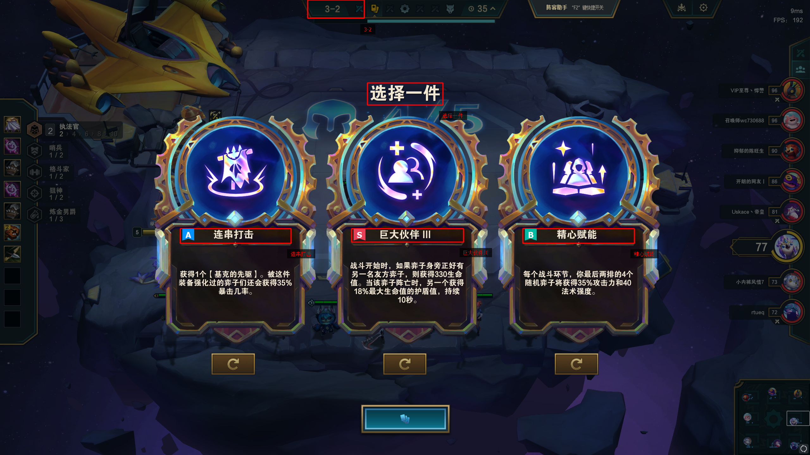
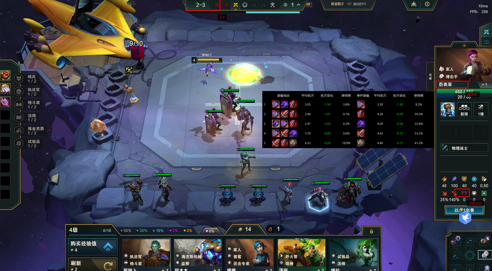

    <h2>TFT-Helper</h2>

    

        
    

## todo ✅
- [x] dx11图像捕捉
- [x] 基础ui
- [x] 悬浮窗口+日志窗口
- [x] ocr识别
- [x] 游戏阶段识别task
- [x] ocr显示debug信息
- [x] 符文强化task + 强度提示
- [x] 英雄task + 装备推荐
- [ ] 神器task + 强度提示

## 符文强化效果展示

## 装备推荐效果展示

## 神器/光明装推荐效果展示（TODO）
